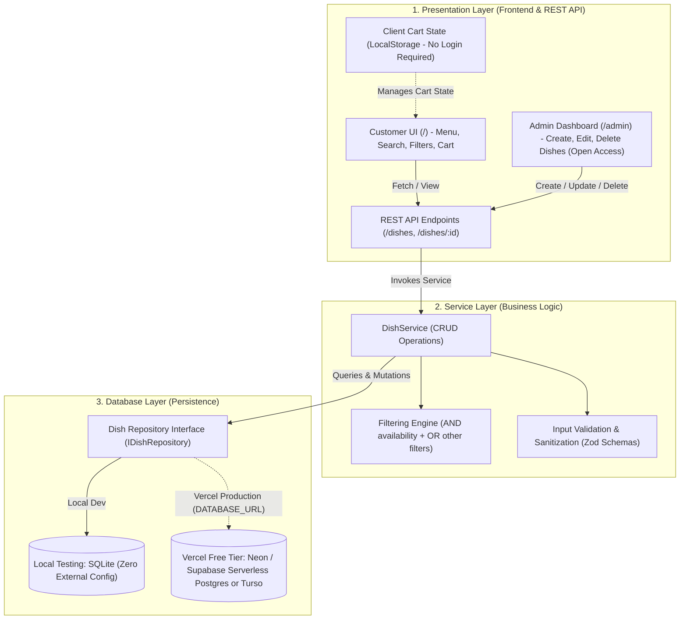

# Desi Dutch Food Platform — System Design & Implementation Specification

A comprehensive technical architecture, data model specification, REST API contract, component breakdown, and phased implementation & testing plan for the **Desi Dutch** food ordering platform, optimized for local testing and zero-cost deployment on the Vercel Free Tier.

---

## 1. System Overview & Scope Simplifications

- **No User / Auth Endpoints for now**: No registration, login, or cross-device session syncing.
- **Client-Side Cart**: Cart state stored directly in browser `LocalStorage`.
- **Open Admin Frontend (`/admin`)**: A dedicated administration interface where dishes can be created (`POST`), edited (`PUT`), and deleted (`DELETE`).
- **Data Model Simplification**: `speciality` and `is_speciality` fields are completely removed.
- **Explicit Filter Combination Logic**:
  - `availability` (`is_available`) is combined using **`AND`** logic.
  - The remaining filter parameters (`daily_special`, `tags`, and `name`) are combined using **`OR`** logic.
- **Future Auth Hardening**: In a subsequent phase, `/admin` will be protected using a lightweight whitelisted `ADMIN_USER` and `ADMIN_PASSWORD` check.



---

## 2. Data Models Specification

### 2.1 Dish Model (`Dish`)
Represents a culinary offering in the Desi Dutch menu.

| Field Name | Type | Constraints | Description | Example |
|---|---|---|---|---|
| `dish_id` | `String` | Primary Key, UUID / CUID | Unique identifier | `"dish_c8f29e1a"` |
| `name` | `String` | Required, Max 120 chars | Name of the dish | `"Keema Bitterballen with Mint Mayo"` |
| `description` | `String` | Required, Max 500 chars | Rich description of taste & ingredients | `"Crispy Dutch croquette filled with slow-cooked spiced minced lamb, served with house mint-coriander mayonnaise."` |
| `photo_url` | `String` | Required, URL format | Public image URL | `"https://images.unsplash.com/photo-..."` |
| `price` | `Float` | Required, Min: 0.01 | Price in EUR (€) | `8.50` |
| `tags` | `String[]` | Required, Min: 1 item | Category & dietary tags | `["snack", "fusion", "spicy"]` |
| `daily_special`| `Boolean` | Default: `false` | Highlighted as today's special | `true` |
| `is_available` | `Boolean` | Default: `true` | Stock availability toggle | `true` |
| `created_at` | `DateTime` | Auto-generated timestamp | Record creation time | `2026-10-06T19:00:00Z` |
| `updated_at` | `DateTime` | Auto-updated timestamp | Record last update time | `2026-10-06T19:00:00Z` |

*(Note: `speciality` and `is_speciality` have been completely dropped.)*

### 2.2 Filter Query Parameters Model (`DishFilterQuery`)

| Query Parameter | Type | Required | Description | Example |
|---|---|---|---|---|
| `availability` / `is_available` | `Boolean` | Optional | **AND filter**: Dishes must match this availability status | `?availability=true` |
| `daily_special` | `Boolean` | Optional | **OR filter**: Matches dishes where `daily_special === true` | `?daily_special=true` |
| `tags` | `String` or `String[]` | Optional | **OR filter**: Matches dishes having any of the specified tags | `?tags=snack,spicy` |
| `name` | `String` | Optional | **OR filter**: Case-insensitive substring match on name | `?name=bitterballen` |

### 2.3 Filter Evaluation Rules & Boolean Logic

When filtering dishes, the service applies:
- **`availability` condition**: Evaluated with **`AND`**. If provided, only dishes matching `dish.is_available === availability` can qualify.
- **Other conditions (`daily_special`, `tags`, `name`)**: Evaluated with **`OR`** among themselves. If one or more of these criteria are provided, a dish satisfies this group if it matches *any* of the specified conditions.

#### Logical Predicate Representation:
```text
Match(dish) = (availability == null OR dish.is_available == availability)
              AND
              (
                No_OR_Filters_Provided
                OR (daily_special != null AND dish.daily_special == daily_special)
                OR (tags != null AND dish.tags intersects tags)
                OR (name != null AND dish.name contains name)
              )
```

#### Example Scenarios:
1. `?availability=true`
   - Returns all dishes that are available.
2. `?availability=true&tags=snack&daily_special=true`
   - Returns dishes that are **available** `AND` (are a **daily special** `OR` have the tag **snack**).
3. `?tags=dessert&name=wafel` (no availability specified)
   - Returns dishes that have tag **dessert** `OR` contain name **wafel**.
4. `?availability=false&daily_special=true`
   - Returns dishes that are **unavailable** `AND` are flagged as **daily special**.

### 2.4 Client Cart Model (`Cart` & `CartItem` - LocalStorage Only)

| Entity | Field | Type | Description |
|---|---|---|---|
| **CartItem** | `dish_id` | `String` | Identifier referencing the `Dish` |
| | `dish` | `Dish` | Snapshot of the dish data (name, price, photo) |
| | `quantity` | `Integer` | Number of servings (Min: 1) |
| **Cart** | `items` | `CartItem[]` | List of items stored in client LocalStorage |
| | `total_items` | `Integer` | Total count of individual dishes |
| | `subtotal` | `Float` | Cumulative price in EUR |

---

## 3. REST API Contract (`/dishes`)

All dish management operations are handled through standard REST verbs on `/dishes`.

### 3.1 `GET /dishes` — List Dishes with Filtering
* **Method**: `GET`
* **Path**: `/dishes`
* **Query Parameters**:
  * `availability` (boolean e.g. `true` or `false` — evaluated via `AND`)
  * `daily_special` (boolean e.g. `true` — evaluated via `OR`)
  * `tags` (string, comma-separated e.g. `snack,vegetarian` — evaluated via `OR`)
  * `name` (string e.g. `Kapsalon` — evaluated via `OR`)
* **Response `200 OK`**:
```json
{
  "success": true,
  "count": 1,
  "data": [
    {
      "dish_id": "dish_01",
      "name": "Kapsalon Chicken Tikka",
      "description": "Fries loaded with spiced tandoori chicken, melted mature Gouda cheese, crunchy salad, and garlic raita.",
      "photo_url": "https://images.unsplash.com/photo-1568901346375-23c9450c58cd",
      "price": 12.95,
      "tags": ["fusion", "main", "halal", "cheese"],
      "daily_special": true,
      "is_available": true,
      "created_at": "2026-10-06T19:00:00.000Z",
      "updated_at": "2026-10-06T19:00:00.000Z"
    }
  ]
}
```

### 3.2 `POST /dishes` — Create Dish (Used by Admin Frontend)
* **Method**: `POST`
* **Path**: `/dishes`
* **Request Headers**: `Content-Type: application/json`
* **Request Body**:
```json
{
  "name": "Masala Stroopwafel",
  "description": "Traditional Dutch thin waffle with warm cardamom, ginger, and saffron spiced caramel.",
  "photo_url": "https://images.unsplash.com/photo-1587314168485-3236d6710814",
  "price": 4.50,
  "tags": ["dessert", "sweet", "vegetarian"],
  "daily_special": false,
  "is_available": true
}
```
* **Response `201 Created`**: Returns created dish object with generated `dish_id` and timestamps.
* **Response `400 Bad Request`**: Validation errors (e.g. negative price, empty name, missing required fields).

### 3.3 `GET /dishes/:id` — Retrieve Single Dish
* **Method**: `GET`
* **Path**: `/dishes/:id`
* **Response `200 OK`**: Single dish object.
* **Response `404 Not Found`**: `{ "success": false, "error": "Dish not found" }`

### 3.4 `PUT /dishes/:id` — Update Dish (Used by Admin Frontend)
* **Method**: `PUT`
* **Path**: `/dishes/:id`
* **Request Body**: Fields to update (e.g., `price`, `daily_special`, `is_available`, `name`, `tags`, `description`, `photo_url`).
* **Response `200 OK`**: Updated dish object.
* **Response `404 Not Found`**: When ID is not found.

### 3.5 `DELETE /dishes/:id` — Delete Dish (Used by Admin Frontend)
* **Method**: `DELETE`
* **Path**: `/dishes/:id`
* **Response `200 OK`**:
```json
{
  "success": true,
  "message": "Dish deleted successfully",
  "dish_id": "dish_02"
}
```
* **Response `404 Not Found`**: When ID is not found.

---

## 4. Components Breakdown

### 4.1 Database Layer Components
1. **Schema Definition (`schema.prisma` or SQLite Schema)**:
   * Entity mapping for `Dish` (with indexes on `name`, `daily_special`, `is_available`).
2. **Repository Abstraction (`IDishRepository`)**:
   * Encapsulates persistence calls: `findMany`, `findById`, `create`, `update`, `delete`.
   * **Local environment**: Zero-config SQLite (`file:./dev.db`).
   * **Vercel Free Tier**: Serverless Postgres (Neon / Supabase) or Turso.
3. **Database Seeder (`seed.ts`)**:
   * Pre-populates the menu with 8–10 authentic Desi Dutch fusion dishes.

### 4.2 Service Layer Components
1. **`DishService`**:
   * Implements filtering logic applying `AND` for availability and `OR` for (`daily_special`, `tags`, `name`).
   * Implements CRUD operations for create, get, update, and delete.
2. **Validation Engine (`dish.validator.ts`)**:
   * Zod schemas guaranteeing positive prices, non-empty tags array, valid URLs, and boolean flags.
3. **Domain Error Handlers**:
   * Typed exceptions (`NotFoundError`, `ValidationError`).

### 4.3 Presentation Layer Components

#### Customer Presentation (`/`)
1. **`Navbar`**: Minimalist header with Desi Dutch branding, navigation links, and floating cart icon with item count badge.
2. **`HeroSection`**: Elegant introduction highlighting Dutch street food infused with Delhi spice.
3. **`FilterToolbar`**:
   * Search input for instant dish name search (OR).
   * Tag pills (All, Snacks, Mains, Desserts, Vegetarian, Spicy) (OR).
   * Daily Special toggle switch (OR).
   * Availability filter switch (AND).
4. **`DishGrid` & `DishCard`**:
   * Clean food photo, tags, price in EUR (€), daily special badge, availability badge.
   * "Add to Cart" button with instant feedback (disabled if unavailable).
5. **`CartDrawer`**:
   * Slide-over cart displaying items, quantity steppers (+/-), item removal, subtotal calculation.
   * Persistent in browser `LocalStorage`.

#### Admin Presentation (`/admin`)
1. **Admin Header & Metric Bar**:
   * Total dishes count, active daily specials count, in-stock vs out-of-stock count, quick link to public view (`/`).
2. **Dish Management Table / Grid**:
   * Table displaying all dishes with quick actions: Edit, Delete, Toggle Availability, Toggle Daily Special.
3. **Dish Editor Modal / Form**:
   * Form to create a new dish (`POST /dishes`) or edit an existing one (`PUT /dishes/:id`).
   * Fields: Name, Description, Photo URL (with instant preview), Price, Tags, Daily Special checkbox, Availability checkbox.
4. **Delete Confirmation Dialog**:
   * Safe confirmation before sending `DELETE /dishes/:id`.

---

## 5. Phased Implementation Plan

```mermaid
flowchart LR
    P1["Phase 1: Project Scaffolding"] --> P2["Phase 2: Database Layer"]
    P2 --> P3["Phase 3: Service Layer"]
    P3 --> P4["Phase 4: REST API Endpoints"]
    P4 --> P5["Phase 5: Local API Testing"]
    P5 --> P6["Phase 6: Customer Frontend"]
    P6 --> P7["Phase 7: Open Admin Frontend"]
    P7 --> P8["Phase 8: Vercel Free Tier Deployment"]
    P8 -.-> P9["Future Phase: Admin Auth Hardening"]
```



### Phase 1: Project Scaffolding & Setup
* Initialize Next.js App Router workspace with TypeScript and Tailwind CSS.
* Set up clean 3-tier folder structure (`src/db`, `src/services`, `src/app`).

### Phase 2: Database Layer & Repository Pattern
* Define data model schema for `Dish` (without speciality).
* Configure local SQLite database client.
* Write database seed script with authentic Desi Dutch fusion dishes.

### Phase 3: Service Layer & Validation Logic
* Implement Zod validation schemas for dish creation and updates.
* Implement `DishService` incorporating the compound filtering rules:
  * Availability evaluated with `AND`.
  * Daily Special, Tags, and Name evaluated with `OR`.

### Phase 4: REST API Handlers (`/dishes`)
* Implement `GET /dishes` supporting `availability`, `daily_special`, `tags`, and `name`.
* Implement `POST /dishes` with status 201.
* Implement `GET /dishes/[id]`, `PUT /dishes/[id]`, and `DELETE /dishes/[id]`.

### Phase 5: Local Testing & Validation of API Layer
* Test all endpoints locally using automated test scripts / cURL.
* Verify compound filter combinations:
  * `?availability=true`
  * `?availability=true&daily_special=true&tags=snack`
  * `?availability=false&name=kapsalon`
* Verify error conditions (invalid payload 400, non-existent ID 404).

### Phase 6: Minimalist, Elegant Customer Frontend (`/`)
* Build responsive layout with warm Dutch minimalist aesthetic.
* Build Filter & Search toolbar with real-time reactive updates.
* Build Dish Card grid and interactive slide-over Cart drawer with LocalStorage persistence.

### Phase 7: Open Admin Frontend (`/admin`)
* Build administration dashboard page.
* Implement Dish Form (Create new dish, Edit existing dish).
* Implement quick toggle for Daily Special and Availability.
* Implement Dish Deletion with confirmation.

### Phase 8: Vercel Free Tier Deployment Preparation
* Configure production serverless database connection (Neon / Supabase / Turso free tier).
* Prepare step-by-step instructions for zero-cost deployment on Vercel.

### Future Phase: Admin Authentication Hardening
* Introduce simple HTTP Basic Auth or session cookie check for `/admin`.
* Match against whitelisted environment variables (`ADMIN_USERNAME` / `ADMIN_PASSWORD`).

---

## 6. Testing Strategy

### 6.1 Local Layered Testing Matrix

| Layer | Test Scope | Verification Method |
|---|---|---|
| **Database** | Schema migrations, seed dataset, CRUD queries | Prisma / SQLite migration verification & seed script |
| **Service** | Filter logic: `AND` on availability, `OR` on (`daily_special`, `tags`, `name`) | Unit tests with varied query scenarios |
| **API Endpoints** | Status codes (200, 201, 400, 404), query parsing, response format | Automated test script / cURL scenarios against local server |
| **Customer UI** | Menu browsing, real-time filtering, Add-to-cart, cart persistence | Local browser verification |
| **Admin UI** | Create dish, edit dish, toggle daily special, toggle availability, delete dish | In-browser end-to-end admin workflow |

### 6.2 Key Verification Scenarios for Filter Logic
1. **Availability Only (`AND`)**: `GET /dishes?availability=true` returns only items where `is_available === true`.
2. **OR Filter Group**: `GET /dishes?tags=snack&daily_special=true` returns dishes that have tag `snack` OR are flagged `daily_special === true`.
3. **Compound `AND` + `OR`**: `GET /dishes?availability=true&tags=snack&daily_special=true` returns dishes that are available `AND` (`snack` `OR` `daily_special`).
4. **Availability Exclusion**: A dish matching `tags=snack` but with `is_available=false` is **excluded** from `GET /dishes?availability=true&tags=snack`.
5. **Create & Update via Admin**: `POST /dishes` and `PUT /dishes/:id` correctly handle availability and daily special flags.
6. **Delete via Admin**: `DELETE /dishes/:id` removes dish, verified by subsequent 404 on `GET /dishes/:id`.

---

## 7. Vercel Free Tier Compatibility Architecture

1. **Serverless Functions**: Next.js route handlers run inside Vercel's free serverless limits (100k requests/day, 10s execution max).
2. **Zero-Cost Production Database**:
   * **Neon PostgreSQL (Free Tier)**: 0.5 GB storage, serverless connection pooler, zero idle cost.
   * **Supabase PostgreSQL (Free Tier)**: 500 MB DB with transaction pooling.
   * **Turso (libSQL)**: 9 GB free storage, instant edge cold starts.
3. **Zero Maintenance Authentication**:
   * Since user authentication is deferred and admin access is open (later whitelisted via env variables), no external auth providers are required, keeping running costs at strictly **$0.00/month**.
